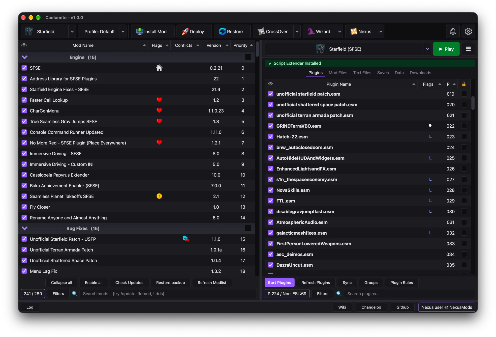

<p align="center">
    
</p>

<h1 align="center">Caelumite</h1>

<h3 align="center">A mod manager for macOS, for Windows games in CrossOver.</h3>

<h5 align="center">
  <a href="https://github.com/tomislav/caelumite/issues">Issues</a> |
  <a href="docs/NEXUS.md">Nexus Mods</a> |
  <a href="docs/UPSTREAM.md">Upstream</a> |
  <a href="https://github.com/ChrisDKN/Amethyst-Mod-Manager">Amethyst Mod Manager</a>
</h5>

<p align="center">
    
</p>

Caelumite is a macOS-only fork of
[Amethyst Mod Manager](https://github.com/ChrisDKN/Amethyst-Mod-Manager) by
ChrisDKN. Nearly all of the mod-management code is Amethyst's; Caelumite adds
the macOS platform layer and keeps merging upstream releases.

Report bugs and ideas in this repository's
[issues](https://github.com/tomislav/caelumite/issues). If Caelumite is
useful to you, please support the original project: endorse
[Amethyst on Nexus Mods](https://www.nexusmods.com/site/mods/1714), star
[its repository](https://github.com/ChrisDKN/Amethyst-Mod-Manager) or
[buy ChrisDKN a coffee on Ko-fi](https://ko-fi.com/chrisdkn).

## Key Features

- **MO2-style interface** - mod list with separators, priorities, flags and
  conflicts on the left; plugins, mod files, saves and the game's data on
  the right.
- **CrossOver integration** - finds every CrossOver bottle and the Windows
  Steam inside it, so installed Steam games are detected automatically. Play,
  tools and wizards all run in the game's bottle.
- **Hardlink deployment** - mods are hardlinked into the game folder, so the
  game reads plain files at full speed with nothing injected at runtime.
  Restore puts the game folder back exactly as it was.
- **Script extenders** - a detected loader (SFSE, SKSE64, F4SE, ...) is the
  default Play entry. Caelumite starts the bottle's Steam first, so the game
  doesn't relaunch without it.
- **LOOT built in** - libloot sorts plugins in-app, with masterlist updates,
  LOOT userlists, groups and rule editing.
- **FOMOD and BAIN installers** - with saved choices, so reinstalls and
  updates remember your options.
- **Conflict detection** - loose-file and BSA/BA2 archive conflicts, per mod
  and file by file.
- **Root folder installs** - deploy any mod, such as a script extender, to
  the game folder instead of `Data` with a right-click.
- **Nexus links and update checks** - "Mod Manager Download" links open in
  Caelumite (`nxm://`), and all mods can be checked for updates at once. Nexus
  login is limited for now - see [Nexus Mods](#nexus-mods).
- **Import from Mod Organizer 2** - bring over an MO2 instance's mods, load
  order and separators in seconds, as APFS clones that take almost no extra
  disk space.
- **Tool wizards** - set up and run modding tools such as xEdit in a few
  clicks, inside the game's bottle.
- **Profiles** - separate mod lists, load orders, INIs and saves per profile.
- **A real Mac app** - native menu bar, keyboard shortcuts, Keychain storage
  for credentials, and a title bar that follows the theme.
- **Many games** - Caelumite inherits Amethyst's support for almost 100
  games (all Bethesda titles, Cyberpunk 2077, Baldur's Gate 3, RE Engine and
  BepInEx games, ...). So far it has been tested on macOS with Starfield.

## How it works on macOS

- **Games live in CrossOver bottles.** The game's bottle is its prefix.
- **Mods are hardlinked into the game folder.** Keep mod staging
  (`~/Games/Caelumite` by default) on the same disk as the bottle, or
  deployment falls back to slower symlinks or copies.
- **Play runs in the bottle.** Play hands off to the bottle's Steam
  (`steam.exe -applaunch`), or runs the exe directly with launch mode
  *None*. A script extender entry starts the bottle's Steam, then the loader.
- **Two links are added to each game bottle,** so paths written for
  Proton land in the bottle: `drive_c/users/steamuser` → the bottle's real
  user (`crossover`), for the plugins.txt, INI and save paths Amethyst's game
  handlers use, and `pfx` → the bottle itself, for tools that reach a
  prefix as `<compatdata>/pfx`. Wine ignores both.

Config lives in `~/Library/Application Support/Caelumite`.

## Requirements

- macOS on Apple silicon or Intel
- [CrossOver](https://www.codeweavers.com/crossover) with your game installed
  in a bottle
- Homebrew Python 3.12–3.14, Rust (`brew install python@3.14 rust`) and the
  Xcode command line tools (`xcode-select --install`)

## Install from source

```bash
git clone https://github.com/tomislav/caelumite
```

```bash
scripts/setup-macos.sh
```

```bash
scripts/build-app.sh
```

The setup script creates `.venv`, installs the Python dependencies and builds
the two native extensions (the deployment catalog and libloot) into `src/`.
`build-app.sh` builds `build/Caelumite.app`, which gives Caelumite its name
and icon in the menu bar, Dock and app switcher, and opens Nexus "Mod Manager
Download" links. Drag it into `/Applications` if you like, or start it with:

```bash
./caelumite
```

The app runs this checkout, so code changes need no rebuild; rebuild after
`scripts/setup-macos.sh` or a Homebrew Python upgrade. On start, Caelumite
makes itself the default `nxm://` handler, and the handler for Thunderstore
`ror2mm://` and `modl://` links unless another app already handles them.

## Building a release

`scripts/build_release.py` builds a self-contained `Caelumite.app` for Apple
silicon (macOS 14 or later):
- it embeds its own Python ([python-build-standalone](https://github.com/astral-sh/python-build-standalone)),
  the app code, the Qt parts the app uses and [7-Zip](https://www.7-zip.org);
- it signs everything with your Developer ID and the hardened runtime;
- it notarizes the app, then packages and notarizes a disk image.

```bash
.venv/bin/python scripts/build_release.py
```

It needs a "Developer ID Application" certificate in your keychain and
notary credentials stored once with:

```bash
xcrun notarytool store-credentials caelumite --apple-id <Apple ID> --team-id <Team ID>
```

`--identity -` builds an ad-hoc signed copy for local testing, and
`--no-notarize` skips Apple's service. The pinned Python and 7-Zip downloads
are cached and checksummed in `build/cache/`. Output goes to
`build/release/`.

## Nexus Mods

Caelumite isn't registered with Nexus Mods yet, so Nexus login is off in
public builds. For testing and personal use you can log in with your personal
API key; see [docs/NEXUS.md](docs/NEXUS.md). Installing from downloaded
archives, deploying, LOOT and the wizards all work without Nexus.

## Importing from Mod Organizer 2

Caelumite uses MO2's mod-folder and load-order formats, so an MO2 instance
(for example one in a CrossOver bottle) imports as-is:

```bash
.venv/bin/python scripts/import_mo2.py "<MO2 instance folder>" ~/Games/Caelumite/<Game>
```

Mods and the overwrite folder are copied as APFS clones (instant, almost no
extra disk space, independent of MO2), and the MO2 profile's load order
replaces the Caelumite profile's after a backup. Separators keep their mods:
MO2 writes a separator after its mods in `modlist.txt` and Caelumite reads it
before them, so the import moves each one. MO2 itself isn't changed. Close
Caelumite first, and press Refresh Modlist once after the import so conflicts
are indexed.

## Not supported on macOS (yet)

- Tool prefixes separate from the game's bottle: every tool runs in the game's
  bottle.
- Windows component installers (VC++, .NET, XAudio): install them with
  CrossOver's own "Install Software" instead.
- Steam-style launch options (`%command%`), the Linux VFS deploy method,
  Wayland, LSFG and MangoHud.
- Wabbajack (texture conversion and MPI installers need Proton), and the
  wizards that run Linux-native tools or Proton-only texture conversion:
  ReShade, BodySlide/Outfit Studio (Linux builds - the Windows BodySlide
  wizard still works once BodySlide is installed as a mod), TTW, BSA
  Decompressor, ESM Fixes, me3, Regulation Merge, YeetPatch, VRAMr,
  BENDr, ParallaxR and Synthesis. See `src/Utils/macos/wizard.py`.

## Keeping up with upstream

See [docs/UPSTREAM.md](docs/UPSTREAM.md).

## License

GPL-3.0, like upstream. See [LICENSE](LICENSE).
